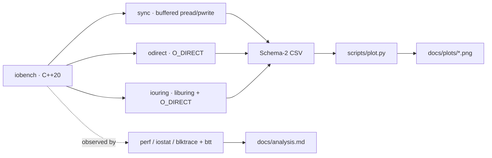
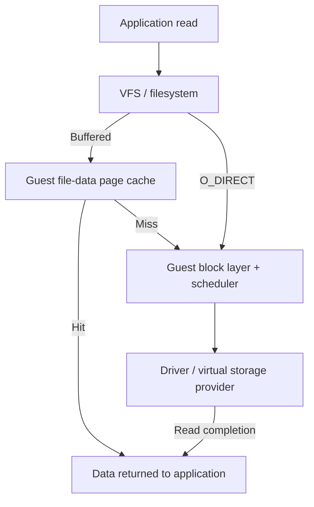
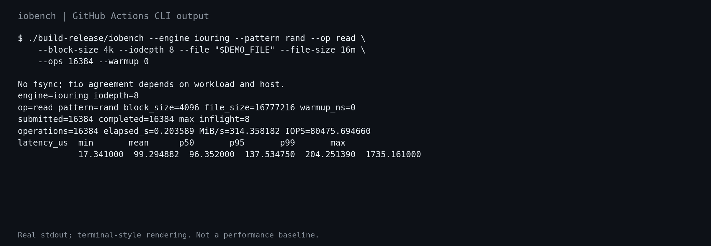
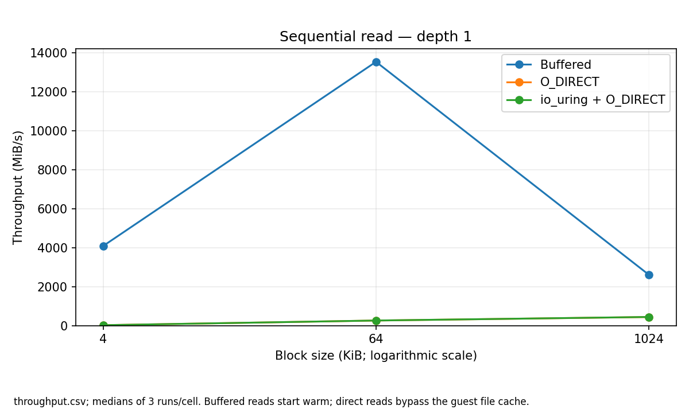
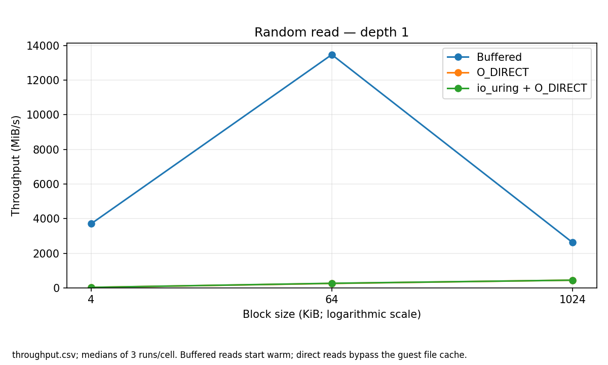
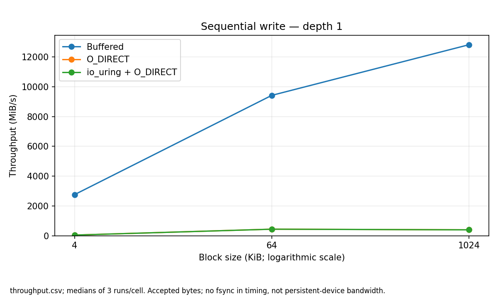
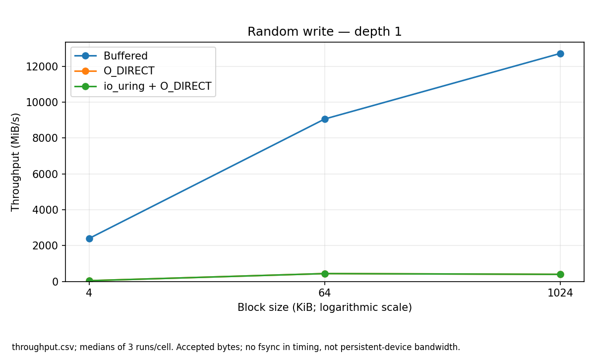
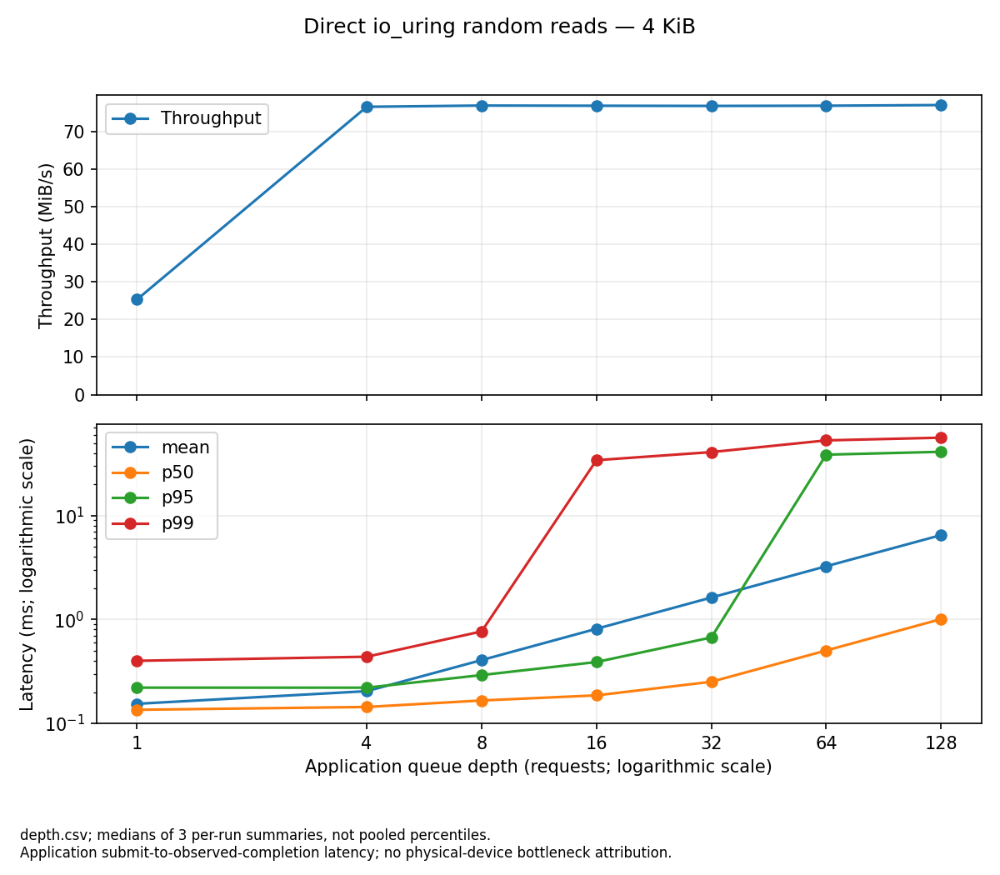
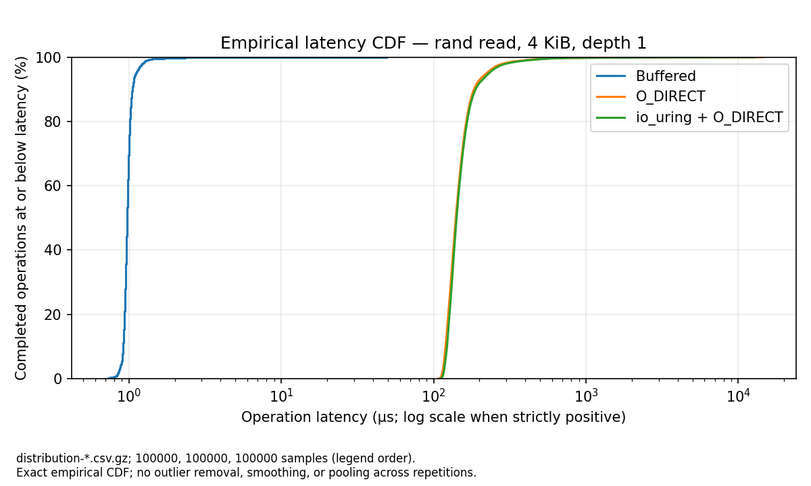
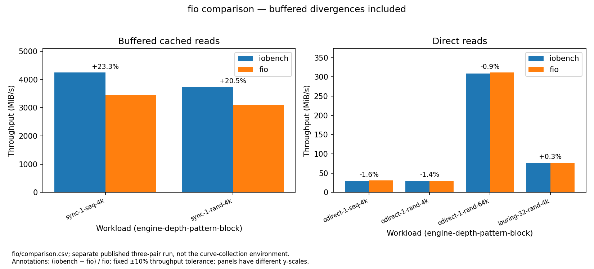

# Storage I/O Benchmark & Linux I/O Path Analysis

[](https://github.com/IV-cmd/storage-io-benchmark/actions/workflows/ci.yml)

A C++20/Linux single-file benchmark comparing buffered `pread`/`pwrite`,
`O_DIRECT` and direct `io_uring` across block sizes and queue depths.
It records operation latencies, throughput and completion accounting, with
pandas/matplotlib visualizations and Linux I/O-path analysis.
Read cross-validation against fio is partial: the published repeated run passes
four of six workloads at a fixed ±10% throughput tolerance.

[Architecture](#architecture) · [Quickstart and CLI](#quickstart) ·
[Measured plots](#measured-results) · [Validation and limits](#validated-divergent-and-untested)

## Architecture



One userspace thread owns the workload. Synchronous engines require depth one;
io_uring overlaps requests using independently owned, aligned buffers.
Direct engines query filesystem/device alignment and fail rather than silently
fall back. See [analysis](docs/analysis.md), [tuning](docs/tuning.md) and
[encountered caveats](docs/caveats.md).

### Linux read paths



This is a conceptual path diagram, not a measured trace or timing breakdown.
Both direct engines still use the filesystem; they bypass the guest file-data
cache, not every cache in the storage stack. io_uring changes submission,
completion and concurrency, not that cache distinction. A buffered miss also
populates the page cache; that return path is omitted for clarity.

## Quickstart

Install the Linux/C++ dependencies in [setup](docs/setup.md), then:

**Use a disposable regular file on an existing writable block-backed mount.
Writes overwrite data; read preparation also needs write access.** Replace
`/mnt/test` below with that mount, not a raw device or valuable file.

```sh
make release
mkdir -p results
./build-release/iobench --engine iouring --pattern rand --op read \
  --block-size 4k --iodepth 32 --file /mnt/test/disposable.data \
  --duration 5s --output csv > results/read.csv

python3 -m venv .venv
. .venv/bin/activate
python -m pip install -r requirements.txt
make plots

make validate SCRATCH=/mnt/test
make observe SCRATCH=/mnt/test
```

`make plots` regenerates the committed figures from `docs/data/`; a single
`results/read.csv` is not a full curve dataset. To collect new curves and choose
another input directory, see [plot reproduction](docs/plotting.md).
`make validate` calls `scripts/validate_fio.py`; tolerance failures return
nonzero and remain visible. Observation tools need the documented permissions.

Defaults: sequential reads, 4 KiB blocks, a 1 GiB range, one-second discarded
warmup and five measured seconds. `--ops N` replaces duration, not warmup.
Sizes accept binary `k`/`m`/`g` suffixes; times accept seconds or `ms`.
Use `./build-release/iobench --help` for options. Read setup fills new regions
but does not repair existing sparse/unwritten extents.

### What a run looks like

This project is a CLI, not a graphical application:



Terminal-style rendering of the command and unedited stdout from the
[Actions example](https://github.com/IV-cmd/storage-io-benchmark/actions/runs/45334568869), not a live terminal screenshot.
[Raw stdout](docs/images/cli-run.txt) and
[exact command, host and source commit](docs/images/cli-run.json) are preserved;
`DEMO_FILE` denotes the disposable file recorded there.

The example uses a 16 MiB file and 16,384 operations to demonstrate the output
format. It is not a controlled performance comparison or an input to the plots
below; it uses a different hosted runner and guest storage path. To recreate it,
run the manual
[CLI capture workflow](https://github.com/IV-cmd/storage-io-benchmark/actions/workflows/cli-demo.yml).

## Measured results

The [curve capture](https://github.com/IV-cmd/storage-io-benchmark/actions/runs/45324316546)
used Linux 7.0.0-1017-azure and ext4 on `/dev/sda1`, model `Virtual Disk`.
The underlying physical media is unidentified.

A populated 256 MiB file, disabled warmup and three repetitions were used:
two measured seconds per throughput cell and five per queue-depth cell.
[Provenance](docs/data/sources.json) preserves exact commands, mount options
and residency checks; distributions retain 100,000 operations per engine.

Representative random 4 KiB reads, depth one, median of per-run summaries:

| Engine | MiB/s | Mean, µs | p99, µs | Guest file-cache condition |
|---|---:|---:|---:|---|
| Buffered | 3,700.56 | 0.971 | 1.282 | Preloaded; fully resident |
| O_DIRECT | 25.20 | 154.856 | 419.433 | Evicted before; zero resident after |
| io_uring + O_DIRECT | 25.79 | 151.357 | 359.877 | Evicted before; zero resident after |

These intentionally contrast cache paths, not equal amounts of device work:
warm buffered throughput is not physical-device bandwidth. Buffered writes
measure bytes accepted without fsync, not persistent bandwidth.

### Sequential reads versus block size



All three engines use depth one. Every repetition is retained, including the
unexplained buffered-read drop at 1 MiB blocks; the capture did not isolate its
cause. See the [curve conditions](docs/plotting.md#published-curve-conditions).

### Random reads versus block size



Buffered reads start fully resident; direct reads bypass that guest file cache.
The gap is not evidence that the underlying storage became faster.

### Sequential writes versus block size



These are accepted-byte rates, not durable-media bandwidth. Neither buffered
nor direct completion establishes power-loss durability in this experiment.

### Random writes versus block size



Writes repeatedly overwrite the same 256 MiB range with a fixed compressible
pattern. No fsync is included in timing; this is not a sustained writeback test.

### Queue depth: throughput versus latency



The two panels keep throughput and latency on separate, labelled axes. The
latency panel uses a logarithmic scale so typical values and long tails remain
visible. Lines connect measured depths; they are not fitted predictions.
The earlier controlled [readahead/scheduler analysis](docs/analysis.md) is a
separate capture, not a paired decomposition of these curves.

### Latency distribution



Each curve contains 100,000 observed completions from one distribution run.
The y-axis gives the percentage completed at or below the latency on the x-axis.
These are exact empirical CDFs, without smoothing, outlier removal or pooling
across repetitions. They are separate runs from the depth-sweep summaries.

### fio cross-validation



The fio figure retains the original [three-pair read comparison](https://github.com/IV-cmd/storage-io-benchmark/actions/runs/45015819653),
not a fresh all-pass claim. Buffered sequential/random throughput differences
are **+23.3%/+20.5%**. Buffered/direct panels use different y-scales so the small
direct-I/O rates remain readable.

Inputs, aggregation and provenance are documented in [plotting](docs/plotting.md).

## Validated, divergent and untested

**Validated:** the retained repeated fio run passes four direct-I/O cells.
Six focused tests cover statistics, offsets, tiny write/read integrity,
alignment rejection and io_uring completion accounting under ASan/UBSan without
suppressions. Release checks cover all engines, both patterns/operations and
three block sizes, including CSV parsing and known written-byte checks.
There is **no per-operation runtime checksum**.

**Divergent:** cached buffered reads remain outside tolerance. A separate
fixed-count experiment showed that reducing fio timing/statistics work nearly
eliminated its gap, demonstrating instrumentation sensitivity. It did not prove
every cause of the larger repeated-run discrepancy. fio `lat` versus `clat`
does not explain a throughput mismatch. See the [investigation](docs/validation.md#cached-read-investigation).
Main CI warns on tolerance misses; the dedicated repeated-validation workflow
fails on them. Green CI is not universal fio agreement.

**Encountered caveats:** tmpfs accepted `O_DIRECT` on the tested kernel;
the application explicitly refused the measurement rather than inventing
`EINVAL`. OverlayFS can add copy-up work, including during read-mode setup.
Use a regular file on an actual VM block-backed filesystem. Hardware cache-event
capture failed and BFQ was unavailable in the controlled analysis.
[Caveats](docs/caveats.md) records the evidence and remaining uncertainty.

**Limits:** Linux only; one file, one userspace thread, no concurrent multi-job
mode. Results are host/cache/workload-specific virtual-storage observations,
not SSD/HDD identification, bare-metal ratings or latency guarantees.
Writes use a fixed compressible pattern, lack fio cross-validation, and do not
test durability or power loss. Raw sample memory grows with operation count.
No injected I/O-failure, fairness or long-running writeback study is included.

## Measurement and CSV contract

Per-operation `steady_clock` intervals start after offset generation, just before
backend submission, and end at observed completion. Async values include
queueing and userspace reap delay.
Overall phase time includes offset generation, sample recording and final
draining, but excludes setup, warmup, statistics and CSV formatting.
Whole-process perf counters include those excluded phases.

Random offsets are uniform aligned blocks, with replacement and seed 42.
Sequential offsets wrap; warmup drains and restarts the offset generator before
measurement. Percentiles interpolate at sorted position `(n - 1) * p / 100`.
Outstanding requests drain after a duration limit; blocked I/O can exceed it.

### CSV contract

`--output csv` writes one header, measured `sample` rows and one `summary`
to stdout; errors use stderr. Schema version **2** contains:

```text
schema_version,record_type,engine,iodepth,op,block_size,file_size,pattern,warmup_ns,seq,offset,latency_ns,operations,bytes,elapsed_ns,mib_per_s,iops,min_us,mean_us,p50_us,p95_us,p99_us,max_us,submitted,completed,max_inflight
```

Sizes/offsets are bytes; raw sample/phase/warmup times are nanoseconds; summary
latencies are microseconds. Sample-only fields are empty on summaries and vice
versa. `seq` is observed completion order, not submission order.
Measured submitted/completed/operation counts must agree.
`max_inflight` is peak occupied application slots, not hardware queue occupancy.
MiB/s and IOPS divide completed logical bytes/operations by phase elapsed time.

## Not yet implemented

- Concurrent multi-job benchmarking and fairness analysis.
- bpftrace/biolatency kernel-side timing breakdown.
- NVMe-specific analysis on identified hardware.
- Automated regression comparisons across kernel versions.

These are possibilities, not delivered features or performance claims.

## Development and further reading

`make build` · `make test` · `make format-check` · `make tidy` · `make test-asan`.
Use unsanitized release binaries for measurements; CI also regenerates the plots.

[Setup](docs/setup.md) · [Analysis](docs/analysis.md) · [Tuning](docs/tuning.md) ·
[Caveats](docs/caveats.md) · [fio validation](docs/validation.md) ·
[Plotting](docs/plotting.md) · [Earlier cache experiment](docs/cache-bypass.md) ·
[Learning log](LEARNING_LOG.md).

MIT licensed; see [LICENSE](LICENSE).
